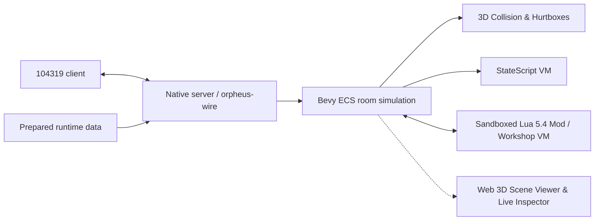

# ORPHEUS

[](https://www.rust-lang.org/)
[](LICENSE)
[](https://github.com/leafall903/ORPHEUS/actions/workflows/public-checks.yml?query=branch%3Arust)
[](https://discord.gg/tqukqjAk7)
[](CONTRIBUTING.md)

[简体中文](README.zh-CN.md) · [Quick start](#public-rust-tests-no-game-files-required) · [Web 3D Viewer](#interactive-web-3d-scene-viewer--live-inspector) · [Lua 5.4 Mods](#lua-54-mod--workshop-system) · [Current status](#current-status) · [Contribute](#contributing) · [Discord](https://discord.gg/tqukqjAk7)

**ORPHEUS is an independent, open-source Rust dedicated server reimplementation for Overwatch 1 (retail build 1.74.0.0.104319).** Designed for protocol research, custom Workshop modding, and game preservation, it features a high-rate Bevy ECS combat simulation, an embedded **Interactive Web 3D Scene Viewer**, and a **Sandboxed Lua 5.4 Workshop / Mod VM**.

- **Rust ECS Simulation & Generic StateScript VM.** Bevy ECS drives 62.5 Hz room physics, multi-capsule skeletal hurtboxes, projectiles, barriers, and generic startup/abilities across all 32 heroes, split into standalone `orpheus-wire`, `orpheus-collision`, `orpheus-runtime`, and `orpheus-statescript` crates.
- **Interactive Web 3D Scene Viewer (`--debug-port`).** Zero-install browser 3D Orbit (`X / Y / Z`) + orthographic Top/Elevation inspector for live map collision meshes, 3D AABB bounds, actor capsules, hitscan/script raycasts, AI patrol routes, StateScript VM states, and live room pause / single-step controls.
- **Hot-Reloadable Lua 5.4 Mod & Workshop System (`--mod-script`).** Per-room isolated Lua 5.4 VMs (ABI v2) with custom gravity/speed/cooldown/time-scale rules, 12 gameplay hooks, 20+ native Overwatch 1.74 actions (live hero swap, bot spawning, status effects, impulses, custom projectiles), and instant `reload` hot-swapping.
- **Try the source without a game install.** The public workspace regression suite runs entirely on synthetic fixtures.

[](docs/assets/scene-inspector.png)

*The project’s Web Scene Viewer & Inspector rendered with a synthetic arena and example timing data. [Open the static screenshot](docs/assets/scene-inspector.png).*

**Branches.** [`rust`](https://github.com/leafall903/ORPHEUS/tree/rust) is the GitHub default branch and the target for all active development. [`python`](https://github.com/leafall903/ORPHEUS/tree/python) preserves the archived Python server, legacy launcher, extractors, and reference tests. [Branch guide](docs/BRANCH_TRANSITION.md)

---

## Interactive Web 3D Scene Viewer & Live Inspector

Build with `--features inspector` (enabled automatically by `scripts/setup_and_play.ps1`) and open **`http://127.0.0.1:3726/`** in any browser to inspect live 3D server simulation state over loopback HTTP with zero external dependencies:

- **3D Perspective Orbit + Dual Orthographic Views:** Drag to rotate and scroll to zoom inside the full-width **3D Orbit (`X / Y / Z`)** viewport, synchronized with **Top (`X / Z`)** and **Elevation (`X / Y`)** projections.
- **3D Map Collision & Raycast Forensics:** Sample arbitrary `(X, Y, Z)` regions or follow any live player/bot to render map collision triangles, 3D broad-phase contact bounds, ground probes, surface normals, weapon/StateScript raycasts, and dual-engine `/api/debug/v1/collision-compare` checks.
- **Live StateScript VM & Telemetry Panels:** Inspect active StateScript graph instances, states, and synced variables per entity, plus worker tick/scheduling latency percentiles and isolated room fault logs.
- **Live Room Time-Travel Controls (`--debug-control`):** Pause any active match room, advance deterministic simulation ticks (`1..60` steps at a time), and resume live play directly from the browser toolbar.

```powershell
cargo run --locked --features inspector,lua-mods --bin orpheus_server -- --data-dir 'C:\path\to\local-state' --debug-port 3726 --debug-control
```

---

## Lua 5.4 Mod & Workshop System

Build with `--features lua-mods` (or `inspector,lua-mods`) and pass `--mod-script <file.lua>` to create custom game modes in a **strictly sandboxed, per-room Lua 5.4 VM** (`StdLib::NONE`, 512 KiB heap cap, 16,384-instruction per-hook budget, zero filesystem/OS/network access, per-hook fault isolation, and atomic console `reload` hot-swap). Full reference: **[docs/LUA_MOD_API.md](docs/LUA_MOD_API.md)**.

- **Live Room Rules:** `damage_scale`, `healing_scale`, `gravity_scale`, `speed_scale`, `ult_charge_scale`, `cooldown_scale`, `time_scale` (slow-mo / fast-forward), `friendly_fire`
- **12 Event Hooks:** `on_room_start`, `on_player_join`, `on_player_leave`, `on_player_spawn`, `on_hero_switch`, `on_damage`, `on_heal`, `on_kill`, `on_button`, `on_emote`, `on_chat`, `on_tick`
- **20+ Native Actions & World Queries:** `set_hero` (live hero switch), `spawn_bot` / `despawn_bot` / `set_bot_ai`, `spawn_projectile`, `set_status` / `clear_status` (`stun`, `sleep`, `freeze`, `anti_heal`, `hack`, `invulnerable`), `apply_impulse` / `teleport` / `set_facing`, `set_ult_charge` / `reset_cooldowns`, `play_emote` / `play_voiceline` / `place_spray`, plus `world.raycast`, `world.players_in_radius`, and `vec3` math helpers
- **Bundled Showcase Mods:**
  - [`rust/scripts/mods/dance_party_workshop.lua`](rust/scripts/mods/dance_party_workshop.lua) — Full ABI v2 interactive Workshop showcase (`!danceall`, `!hero`, `!bot`, `!fireball`, `!slowmo`, `!grav`, `!ult`, `!tp`, `!stun`)
  - [`rust/scripts/mods/low_gravity_arena.lua`](rust/scripts/mods/low_gravity_arena.lua) — Low-Gravity Arena with jump/melee knockback impulses and killstreaks
  - [`rust/scripts/mods/headshot_only_practice.lua`](rust/scripts/mods/headshot_only_practice.lua) — Headshot-Only Practice with critical-hit lifesteal

```lua
return {
    abi = 2,
    info = { name = "Headshot-Only Practice", version = "1.0.0", author = "ORPHEUS" },
    rules = { cooldown_scale = 0.5, gravity_scale = 0.85 },
    on_damage = function(ctx, event, world)
        if not event.headshot and not event.melee then
            return { damage = 0.0, actions = {} }
        end
    end,
}
```

Type `reload` + Enter in the server console at any time to hot-reload your Lua mod across live rooms without restarting the server or client.

---

## Prepare a runtime and run the native server

Use your local **1.74.0.0.104319** installation to prepare a private Practice Range pack on Windows. Separately supply the required research tables, protocol descriptors and private signing inputs. The build command lists anything missing and caches completed extraction stages for the next run. The runtime guide lists the prerequisites and inputs. [Runtime data guide](data/README.md)

```powershell
python scripts/runtime.py build "C:\Games\Overwatch"
python scripts/runtime.py check --complete
```

To reuse authorized prepared inputs or choose a new output directory, pass `--inputs <directory>` or `--output <directory>` to `build`. Existing packs can be checked on supported server platforms without a game installation. The check reports stock-model coverage and how to rebuild an older pack.

For a quick data check without compiling Rust, use `python scripts/runtime.py check --complete --files-only`. The full check uses `ORPHEUS_SERVER_BIN` if set, or builds the server with Cargo on first use. The Windows launcher works with the built-in Windows PowerShell. Extracting the collision index from the game requires PowerShell 7.

Once the pack passes, the Windows launcher builds the server with the inspector and Lua mod support, opens the 3D viewer at `http://127.0.0.1:3726/` and stores player state under `%LOCALAPPDATA%\ORPHEUS\state`.

```powershell
# Double-click scripts\PLAY_ORPHEUS.cmd, or run:
.\scripts\PLAY_ORPHEUS.cmd -RuntimeDir "$env:LOCALAPPDATA\ORPHEUS\runtime-104319"

# Launch with the ABI v2 Workshop Mod + Web 3D Viewer:
.\scripts\PLAY_ORPHEUS.cmd -RuntimeDir "$env:LOCALAPPDATA\ORPHEUS\runtime-104319" -ModScript rust\scripts\mods\dance_party_workshop.lua
```

---

## Public Rust Tests (No Game Files Required)

Install **Git** and **stable Rust** (`>= 1.85.0`). On Windows, install the **x64 MSVC Build Tools** and **Windows SDK** for Rust's MSVC toolchain (`.cargo/config.toml` automatically enables `rust-lld.exe` parallel linking).

```powershell
git clone https://github.com/leafall903/ORPHEUS.git
cd ORPHEUS
cargo test --locked --workspace --all-targets
```

<details>
<summary>Optional Lua AI patrol override and additional CI checks</summary>

Build with `--features lua-debug` and pass `--ai-script <file>` to override StateScript bot patrol decisions with hot-reloadable Lua. The [contribution guide](CONTRIBUTING.md) covers Clippy, Inspector, Lua, MSRV, and shared StateScript contract checks in public CI.

</details>

---

## Current Status

| Area | Implemented (`rust`) | Next Steps |
| --- | --- | --- |
| **Login, Profiles & Gallery** | Native Battle.net RPC, JAM lobby, profile settings persistence (`profile-settings-v1`), career stats flush, and Hero Gallery loadout previews (including 23 NPC previews). | Expand lobby flows and polish Hero Gallery framing. |
| **Practice Range & 32-Hero Combat** | Bevy ECS simulates bots, projectiles, multi-capsule hurtboxes, barriers, deployables, On-Fire HUD, Killcam/POTG, voice/emote/wheel cues, and 32/32 generic retail hero startup & combat kits (including Reinhardt & Zarya tank/barrier/ground-wave foundations contributed by [memcpy](https://github.com/memorycpy)). | Continue live-client edge-case polish across all 32 heroes and multi-client matches. |
| **PvE & PvP Modes** | Consolidated `pve_encounter/` (all 14 Junkenstein cards) and composable PvP mode contracts (`pvp_mode.rs`: Escort, Assault, Hybrid, Control). | Expand PvE hero roster and live multi-player PvP match flow. |
| **Web 3D Viewer & Modding** | Embedded Web 3D Orbit/Top/Elevation Scene Viewer (`debug_http.rs`), dual-collision compare API, room step-debugger, and sandboxed Lua 5.4 Workshop/Mod API v2 (`mod_script.rs`). | Add custom HUD text/world-icon overlays to the Lua Mod API. |

See the [architecture](docs/NATIVE_SERVER_ARCHITECTURE.md), [Lua Mod API](docs/LUA_MOD_API.md), [evidence and status](docs/STATE.md), [behavior contracts](docs/BEHAVIOR_CONTRACTS.md), and [roadmap](docs/ROADMAP.md).

---

## Architecture and Workspace Layout



| Path | Role |
| --- | --- |
| `rust/src/` | Main server binary (`orpheus_server`), lobby, match worker, replication, ECS combat (`game_combat/`), Lua Mod host (`mod_script.rs`), and HTTP 3D inspector (`debug_http.rs`) |
| `rust/crates/statescript/` (`orpheus-statescript`) | Portable StateScript graph loader, expression evaluator, codec tables, and decoupled VM core |
| `rust/crates/wire/` (`orpheus-wire`) | JAM cipher, framing, codec readers/writers, game datagrams, commands |
| `rust/crates/collision/` (`orpheus-collision`) | Collision cache reader, spatial triangle index, static rays, GJK/contact solver |
| `rust/crates/runtime/` (`orpheus-runtime`) | Runtime manifest inventory, preflight checks, and `prepare_server_runtime` CLI |
| `rust/scripts/mods/` | Bundled Lua 5.4 Workshop mods (`dance_party_workshop.lua`, `low_gravity_arena.lua`, `headshot_only_practice.lua`) and AI patrol scripts |
| `rust/assets/inspector/` | Zero-dependency Web 3D Orbit + Top/Elevation Scene Viewer frontend (`index.html`, `debug.js`, `debug.css`) |
| `fixtures/behavior/`, `scripts/` | JSON behavior fixtures, `setup_and_play.ps1` one-click launcher, and cross-language verifier scripts |
| `relay/` | Windows C++ client TLS relay source |

## Contributing

- **Rust and protocol.** Extend shared hero abilities and StateScript delivery to clients. [Delivery coverage example (#166)](https://github.com/leafall903/ORPHEUS/issues/166)
- **Web 3D Viewer, Lua Mods & ECS.** Expand 3D visualization overlays, Workshop scripting hooks, and navigation building on [#62](https://github.com/leafall903/ORPHEUS/issues/62), [#63](https://github.com/leafall903/ORPHEUS/issues/63), and [#65](https://github.com/leafall903/ORPHEUS/issues/65).
- **Gameplay feedback.** Play Practice Range, Workshop mods, or Junkenstein's Revenge locally with build 104319 and report reproducible gameplay or protocol discrepancies. [Roadmap](docs/ROADMAP.md)

See the [contribution guide](CONTRIBUTING.md), browse [open issues](https://github.com/leafall903/ORPHEUS/issues?q=is%3Aissue+is%3Aopen), or join [Discord](https://discord.gg/tqukqjAk7).

## License & Credits

The source is [MIT-licensed](LICENSE). Upstream research and contributor credits — including [memcpy](https://github.com/memorycpy) (Reinhardt & Zarya mechanics, tank StateScript primitives, and lobby chat) — are documented in [CREDITS.md](CREDITS.md). ORPHEUS is an independent research and preservation project with no affiliation to Blizzard Entertainment. Never commit game clients, commercial assets, signing inputs, keys, credentials, or raw packet captures.
