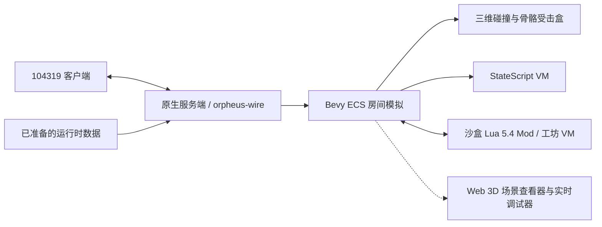

# ORPHEUS

[](https://www.rust-lang.org/)
[](LICENSE)
[](https://github.com/leafall903/ORPHEUS/actions/workflows/public-checks.yml?query=branch%3Arust)
[](https://discord.gg/tqukqjAk7)
[](CONTRIBUTING.md)

[English](README.md) · [快速上手](#启动原生服务端一键整合启动脚本) · [Web 3D 查看器](#交互式网页-3d-场景查看器与实时调试器) · [Lua 5.4 Mod 工坊](#lua-54-mod-与地图工坊系统) · [当前进度](#当前进度) · [参与贡献](#参与贡献) · [Discord](https://discord.gg/tqukqjAk7)

**ORPHEUS 是面向《守望先锋 1》零售版 1.74.0.0.104319 的独立开源 Rust 专用服务端复刻项目。** 项目面向协议研究、自定义地图工坊（Mod）开发与游戏保存，内置高频 Bevy ECS 战斗物理模拟、**交互式网页 3D 场景查看器（Web 3D Viewer）** 以及 **沙盒化 Lua 5.4 Mod / 工坊脚本虚拟机**。

- **Rust ECS 房间模拟与通用 StateScript VM。** 基于 Bevy ECS 驱动 62.5 Hz 房间物理、骨骼多胶囊体受击判定（Hurtbox）、飞行物、护盾部署物以及全部 32 名英雄的通用启动与技能逻辑；底层拆分为 `orpheus-wire`、`orpheus-collision`、`orpheus-runtime` 和 `orpheus-statescript` 独立 crate。
- **交互式网页 3D 场景查看器（`--debug-port`）。** 零外部依赖浏览器原生运行，提供 **3D 自由旋转缩放透视视口（`X / Y / Z`）** 与正交俯视/立面三视图，实时透视地图碰撞三角网、3D 包围盒、角色胶囊体、武器/脚本射线、AI 巡逻路径、StateScript VM 状态以及房间暂停/单步调试。
- **热重载 Lua 5.4 Mod 与地图工坊系统（`--mod-script`）。** 每房间独立隔离的 Lua 5.4 沙盒虚拟机（ABI v2），支持自定义重力/移速/冷却/子弹时间倍率、12 类游戏事件钩子、20+ 原生动作（实时换英雄、刷机器人、状态施加、击退位移、发射自定义投射物等）及控制台 `reload` 秒级无感热重载。
- **无需安装游戏即可运行测试。** 公开工作区回归测试完全基于合成夹具运行，开箱即测。

[](docs/assets/scene-inspector.png)

*项目内置的 Web 3D 场景查看器与调试面板（合成竞技场与耗时示例）。[查看静态截图](docs/assets/scene-inspector.png)。*

**分支说明。** [`rust`](https://github.com/leafall903/ORPHEUS/tree/rust) 是 GitHub 默认主分支，也是当前全部活跃开发的目标分支；[`python`](https://github.com/leafall903/ORPHEUS/tree/python) 归档保留旧版 Python 参考服务端、启动器、提取脚本与早期参考测试（已停止维护）。详见 [分支指南](docs/BRANCH_TRANSITION.md)。

---

## 交互式网页 3D 场景查看器与实时调试器

使用 `--features inspector` 编译（`scripts/setup_and_play.ps1` 默认自动开启）并传入 `--debug-port 3726`，即可在浏览器打开 **`http://127.0.0.1:3726/`** 实时查看服务端三维物理与脚本运行态：

- **交互式 3D 旋转视口 + 双正交投影视图：** 全宽 **3D Orbit（`X / Y / Z`）** 透视画布支持鼠标拖拽自由旋转视角、滚轮无级缩放与一键复位，并与下方 **俯视图（`X / Z`）**、**立面图（`X / Y`）** 实时联动。
- **三维碰撞网格与弹道射线透视：** 支持按任意 `(X, Y, Z)` 坐标或锁定任意在场玩家/机器人实时采样地图碰撞三角网格、宽相接触包围盒（AABB）、地面探测射线、接触法线、命中判定射线/StateScript 射线，并提供 `/api/debug/v1/collision-compare` 双碰撞引擎对比接口。
- **StateScript VM 实时检视与性能遥测：** 实时展开房间内任意实体的 StateScript 图实例树、活跃状态节点与同步变量，同时展示工作线程 Tick 耗时分位数与房间故障隔离记录。
- **房间时间控制（`--debug-control`）：** 直接在网页工具栏对活跃房间执行 **暂停（Pause）**、**逐帧单步推进（Step 1..60 ticks）** 与 **恢复运行（Resume）**。

```powershell
cargo run --locked --features inspector,lua-mods --bin orpheus_server -- --data-dir 'C:\path\to\local-state' --debug-port 3726 --debug-control
```

---

## Lua 5.4 Mod 与地图工坊系统

使用 `--features lua-mods`（或 `inspector,lua-mods`）编译并传入 `--mod-script <file.lua>`，即可在**每房间独立隔离的沙盒 Lua 5.4 虚拟机**（`StdLib::NONE`、512 KiB 内存上限、每次钩子 16,384 条指令预算、零文件/系统/网络权限、单钩子故障自动熔断，支持控制台 `reload` 原子回滚热重载）中编写自定义玩法与地图工坊脚本。完整接口文档见 **[docs/LUA_MOD_API.md](docs/LUA_MOD_API.md)**。

- **全局房间规则（Rules）：** `damage_scale`、`healing_scale`、`gravity_scale`、`speed_scale`、`ult_charge_scale`、`cooldown_scale`、`time_scale`（慢动作/加速）、`friendly_fire`
- **12 个生命周期与战斗钩子：** `on_room_start`、`on_player_join`、`on_player_leave`、`on_player_spawn`、`on_hero_switch`、`on_damage`、`on_heal`、`on_kill`、`on_button`、`on_emote`、`on_chat`、`on_tick`
- **20+ 原生动作与空间查询：** 支持 `set_hero`（实时切换英雄）、`spawn_bot` / `despawn_bot` / `set_bot_ai`（动态生成与控制机器人）、`spawn_projectile`（发射自定义弹道）、`set_status` / `clear_status`（眩晕、睡眠、冰冻、禁疗、黑客入侵、无敌、免控）、`apply_impulse` / `teleport` / `set_facing`、`set_ult_charge` / `reset_cooldowns`、`play_emote` / `play_voiceline` / `place_spray`，以及 `world.raycast`、`world.players_in_radius` 和 `vec3` 向量库
- **内置工坊 Mod 示例：**
  - [`rust/scripts/mods/dance_party_workshop.lua`](rust/scripts/mods/dance_party_workshop.lua) — ABI v2 全功能工坊演示（支持聊天指令 `!danceall`、`!hero`、`!bot`、`!fireball`、`!slowmo`、`!grav`、`!ult`、`!tp`、`!stun` 等）
  - [`rust/scripts/mods/low_gravity_arena.lua`](rust/scripts/mods/low_gravity_arena.lua) — 低重力竞技场（跳跃/近战冲击波与连杀反馈）
  - [`rust/scripts/mods/headshot_only_practice.lua`](rust/scripts/mods/headshot_only_practice.lua) — 爆头专练模式（非爆头免伤 + 暴击吸血）

```lua
return {
    abi = 2,
    info = { name = "Headshot-Only Practice", version = "1.0.0", author = "ORPHEUS" },
    rules = { cooldown_scale = 0.5, gravity_scale = 0.85 },
    on_damage = function(ctx, event, world)
        if not event.headshot and not event.melee then
            return { damage = 0.0, actions = {} }
        end
    end,
}
```

对局过程中在服务端终端输入 `reload` + 回车，即可在不重启服务端与客户端的情况下实时热更新 Mod 脚本。

---

## 准备运行包并启动原生服务端

在 Windows 上，用自己合法持有的 **1.74.0.0.104319** 安装目录生成本地靶场运行包。研究数据表、协议描述文件和私有签名输入需要另行在本地准备。构建命令会列出缺项，已完成的提取步骤会保留在缓存中，补齐后可以重跑。依赖和输入清单见[运行包指南](data/README.md)。

```powershell
python scripts/runtime.py build "C:\Games\Overwatch"
python scripts/runtime.py check
```

在构建命令后追加 `--inputs <目录>` 可复用已有的授权输入，追加 `--output <目录>` 可指定新的输出位置。已有运行包可以在受支持的服务端平台上校验，无需安装游戏。

运行包校验通过后，Windows 启动脚本会编译带调试器和 Lua Mod 支持的服务端，启动 `http://127.0.0.1:3726/` 上的 3D 查看器，并将玩家存档保存在 `%LOCALAPPDATA%\ORPHEUS\state`。

```powershell
# 双击 scripts\PLAY_ORPHEUS.cmd，或在终端运行：
pwsh -File scripts\setup_and_play.ps1 -RuntimeDir "$env:LOCALAPPDATA\ORPHEUS\runtime-104319"

# 同时加载 ABI v2 工坊 Mod 与 Web 3D 查看器启动：
pwsh -File scripts\setup_and_play.ps1 -RuntimeDir "$env:LOCALAPPDATA\ORPHEUS\runtime-104319" -ModScript rust\scripts\mods\dance_party_workshop.lua
```

---

## 运行公开 Rust 测试（无需游戏本体）

安装 **Git** 与 **稳定版 Rust**（`>= 1.85.0`）。在 Windows 上还需安装 **x64 MSVC C++ Build Tools** 与 **Windows SDK**（仓库内置 `.cargo/config.toml` 已自动开启 `rust-lld.exe` 高速并行链接）。

```powershell
git clone https://github.com/leafall903/ORPHEUS.git
cd ORPHEUS
cargo test --locked --workspace --all-targets
```

<details>
<summary>可选 Lua AI 巡逻覆盖与公开 CI 检查</summary>

使用 `--features lua-debug` 编译并传入 `--ai-script <文件>`，可用支持热重载的本地 Lua 脚本覆盖机器人默认 StateScript 巡逻决策。[贡献指南](CONTRIBUTING.md) 收录了 Clippy、Inspector、Lua、最低 Rust 版本（MSRV）和 StateScript 共享契约的完整验证命令。

</details>

---

## 当前进度

| 模块 | 已实现（`rust`） | 下一步 |
| --- | --- | --- |
| **登录、存档与英雄画廊** | 原生 Battle.net RPC、JAM 大厅、玩家设置持久化（`profile-settings-v1`）、生涯数据落盘，以及英雄画廊装备预览（含 23 个 NPC 预览）。 | 扩展大厅流程，持续打磨英雄画廊镜头构图。 |
| **靶场与 32 英雄战斗** | Bevy ECS 模拟机器人与投射物、骨骼多胶囊体受击盒、护盾与部署物、火力全开 HUD、精彩回放/最佳镜头、语音/表情/快捷轮盘，以及全部 32/32 名英雄通用启动与技能闭环（含 [memcpy](https://github.com/memorycpy) 贡献的莱因哈特［大锤］与查莉娅［毛妹］技能机制及裂地猛击地波/护盾原语）。 | 推进全部 32 名英雄边界手感打磨与多客户端联机对局验收。 |
| **PvE 与 PvP 模式** | 统一 `pve_encounter/` 模块（全部 14 张怪鼠复仇卡牌）与可组合 PvP 模式契约（`pvp_mode.rs`：运载/攻防/混合/占领）。 | 扩展 PvE 可选英雄阵容与多人联机 PvP 完整流程。 |
| **Web 3D 查看器与 Mod 系统** | 内置交互式 Web 3D 场景查看器（`debug_http.rs`）、双碰撞对比接口、房间单步控制器，以及沙盒化 Lua 5.4 工坊 Mod API v2（`mod_script.rs`）。 | 为 Lua Mod API 扩展自定义 HUD 文本与三维世界图标接口。 |

更多详情见 [架构与迁移](docs/NATIVE_SERVER_ARCHITECTURE.md) · [Lua Mod 接口文档](docs/LUA_MOD_API.md) · [进度与对等状态](docs/STATE.md) · [行为契约](docs/BEHAVIOR_CONTRACTS.md) · [路线图](docs/ROADMAP.md)。

---

## 架构与目录结构



| 路径 | 职责 |
| --- | --- |
| `rust/src/` | 主服务端（`orpheus_server`）、大厅与匹配、同步投递、ECS 战斗模拟（`game_combat/`）、Lua Mod 宿主（`mod_script.rs`）与 HTTP 3D 查看器服务（`debug_http.rs`） |
| `rust/crates/statescript/`（`orpheus-statescript`） | 图加载、表达式求值、编解码表和独立 VM 核心 |
| `rust/crates/wire/`（`orpheus-wire`） | JAM 加密流、分帧协议、编解码与输入命令报文 |
| `rust/crates/collision/`（`orpheus-collision`） | 碰撞缓存解码、空间三角索引、射线查询与 GJK/EPA 接触求解器 |
| `rust/crates/runtime/`（`orpheus-runtime`） | 运行时清单校验、`--check-runtime` 自检与 `prepare_server_runtime` 打包工具 |
| `rust/scripts/mods/` | 内置 Lua 5.4 工坊 Mod 示例（`dance_party_workshop.lua`、`low_gravity_arena.lua`、`headshot_only_practice.lua`）与巡逻脚本 |
| `rust/assets/inspector/` | 零外部依赖的交互式 Web 3D 旋转视口 + 俯视/立面场景查看器前端（`index.html`、`debug.js`、`debug.css`） |
| `fixtures/behavior/`、`scripts/` | JSON 行为夹具、`setup_and_play.ps1` 一键整合启动器及跨语言校验脚本 |
| `relay/` | Windows C++ 客户端 TLS 中继源码 |

## 参与贡献

- **Rust 与协议。** 持续完善英雄技能细节与 StateScript 状态的客户端投递覆盖。[投递任务示例（#166）](https://github.com/leafall903/ORPHEUS/issues/166)
- **Web 3D 查看器、Lua 工坊与 ECS。** 在 [#62](https://github.com/leafall903/ORPHEUS/issues/62)、[#63](https://github.com/leafall903/ORPHEUS/issues/63) 和 [#65](https://github.com/leafall903/ORPHEUS/issues/65) 的基础上扩展三维可视化图层、工坊脚本能力与寻路表现。
- **实机玩法反馈。** 使用 104319 客户端在本地体验靶场、自定义 Mod 或怪鼠复仇，反馈可复现的技能手感或协议差异。[路线图](docs/ROADMAP.md)

欢迎阅读[贡献指南](CONTRIBUTING.md)、查看[待处理 Issue](https://github.com/leafall903/ORPHEUS/issues?q=is%3Aissue+is%3Aopen)，或加入 [Discord](https://discord.gg/tqukqjAk7)。

## 许可与声明

源码采用 [MIT 协议](LICENSE)，贡献者与致谢（含莱因哈特/大锤与查莉娅/毛妹机制及重装原语贡献者 [memcpy](https://github.com/memorycpy)）详见 [CREDITS.md](CREDITS.md)。ORPHEUS 是独立研究与游戏保存项目，与暴雪娱乐无隶属关系。严禁向公开仓库提交游戏客户端、商业资源、签名输入、密钥、账号数据或原始网络抓包。
